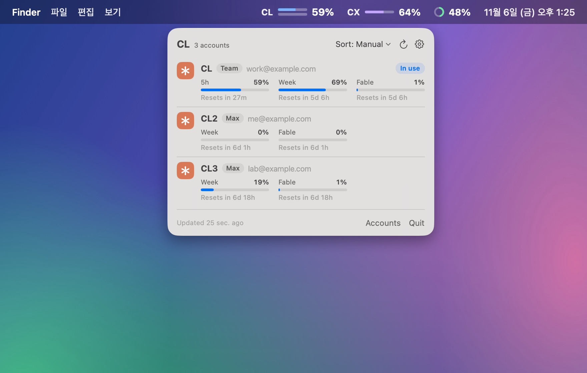
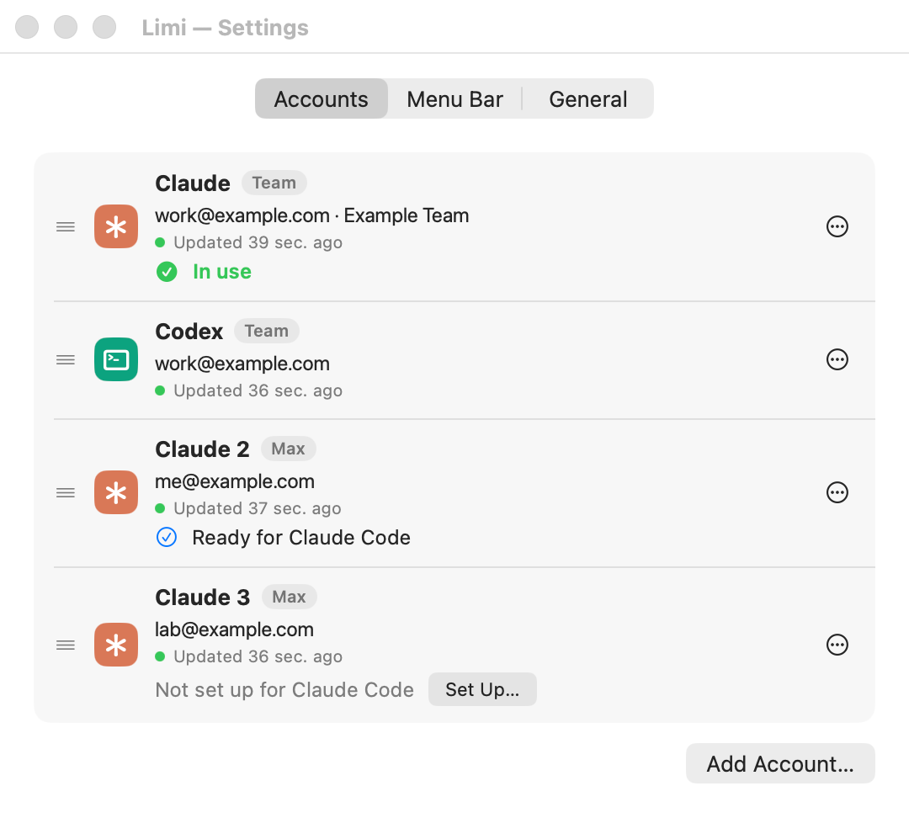
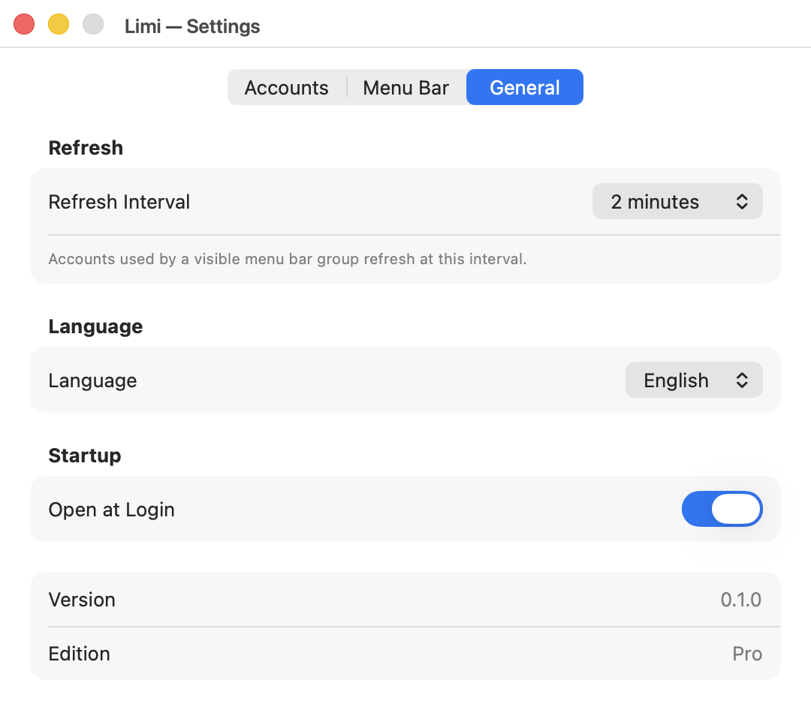
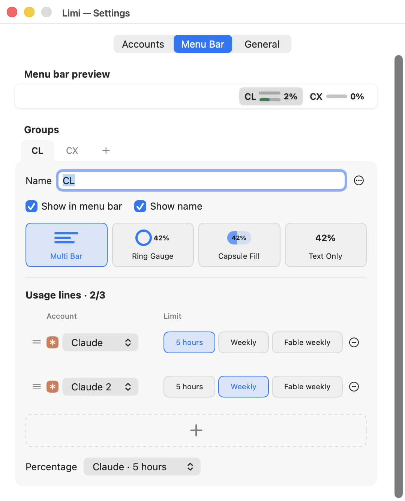
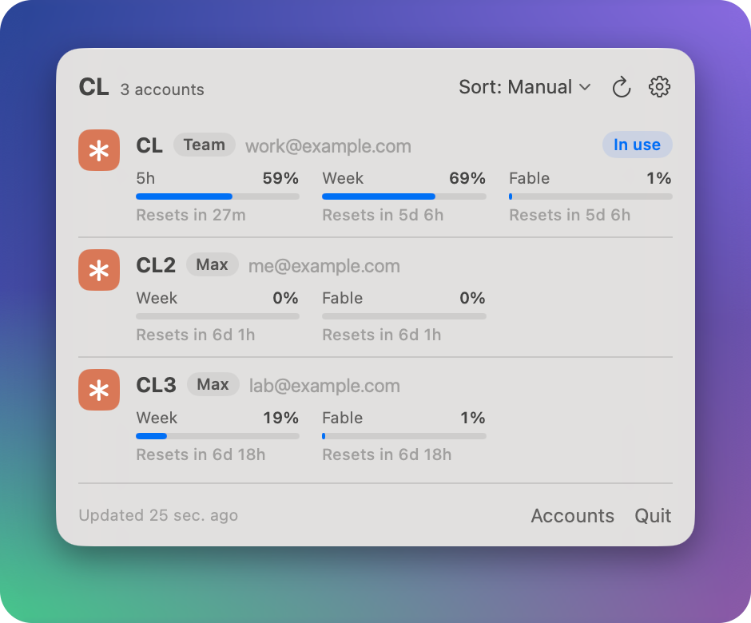
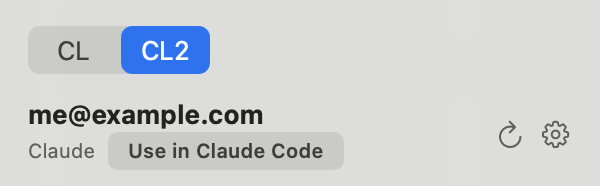

<p align="center">
  
</p>

<h1 align="center">Limi</h1>

<h3 align="center">AI 구독 한도, 메뉴 막대 하나에.</h3>

<p align="center">
  Claude Code와 Codex 계정 여러 개의 5시간·주간 한도를 메뉴 막대에서 바로 봅니다.<br>
  Claude Code 계정도 다시 로그인하지 않고 클릭 한 번에 바꿉니다. 계정 정보는 이 맥에만 둡니다.
</p>

<p align="center">
  <a href="https://github.com/kalti-lab/limi/releases/latest/download/Limi.zip"></a>
</p>

<p align="center">
  <a href="https://kalti.co.kr/ko/limi/"><b>웹사이트</b></a> &nbsp;·&nbsp; <a href="https://kalti.co.kr/ko/"><b>KALTI</b></a> &nbsp;·&nbsp; <a href="README.md">English</a> | <b>한국어</b>
</p>

<p align="center">
  <a href="https://github.com/kalti-lab/limi/releases/latest"></a>
  
  <a href="LICENSE"></a>
</p>

<p align="center">
  
</p>

## IN ACTION<br>실제 화면

<table>
  <tr>
    <td align="center" valign="top" width="50%">
      <br>
      <b>계정 여러 개</b><br><sub>Claude Code와 Codex 계정을 함께 등록</sub>
    </td>
    <td align="center" valign="top" width="50%">
      <br>
      <b>일반 설정</b><br><sub>새로 고침 간격, 언어, 로그인 시 열기</sub>
    </td>
  </tr>
  <tr>
    <td align="center" valign="top">
      <br>
      <b>메뉴 막대 꾸미기</b><br><sub>그룹과 그 계정, 모양, 보여 줄 한도를 원하는 대로</sub>
    </td>
    <td align="center" valign="top">
      <br>
      <b>그룹마다 목록 한 장</b><br><sub>그룹에 넣은 계정을 한도와 함께 모두, 원하는 순서로</sub>
    </td>
  </tr>
</table>

## KEY CAPABILITIES<br>할 수 있는 일

<table>
  <tr>
    <td valign="top" colspan="2">
      <br>
      <b>Claude Code 계정을 클릭 한 번에</b> <sup>새 기능</sup><br>
      평소 쓰는 <code>claude</code>가 쓸 계정을 내 Claude 계정 가운데서 고릅니다. 처음 한 번 로그인해 두면 브라우저가 뜨지 않고, 열린 세션도 30초 안에 따라옵니다.<br><br>
      
    </td>
  </tr>
  <tr>
    <td valign="top" width="50%">
      <br>
      <b>계정 여러 개를 한눈에</b><br>
      Claude Code와 Codex 계정을 함께 넣고, 계정마다 5시간·주간 한도를 봅니다.
    </td>
    <td valign="top" width="50%">
      <br>
      <b>원하는 모양으로</b><br>
      멀티 바, 링 게이지, 캡슐 채우기, 텍스트만 가운데서 고르고, 계정을 그룹으로 묶습니다. 90%를 넘으면 빨간색이 됩니다.
    </td>
  </tr>
  <tr>
    <td valign="top">
      <br>
      <b>계정 정보는 이 맥에만</b><br>
      로그인 정보는 이 맥에만 두고, 칼티로는 아무것도 보내지 않습니다.
    </td>
    <td valign="top">
      <br>
      <b>한국어와 영어</b><br>
      처음에는 영어로 보이고, 설정에서 한국어로 바꿀 수 있습니다.
    </td>
  </tr>
</table>

그 밖에 이런 것도 됩니다.

- **Claude Code에서 쓰기**: 그룹 목록의 Claude 계정에서 **쓰기**를 누르면, 평소 쓰는 `claude`의 로그인이 클릭 한 번에 그 계정으로 바뀝니다. 바꿀 때마다 브라우저로 로그인하지 않아도 됩니다([동작 방식](#claude-code에서-쓰기)).
- 계정의 한도 아래에 **초기화 쿠폰** 수량과 만료일이 표시됩니다. Claude에 주간·Fable 주간처럼 여러 종류가 있으면 **초기화**에서 종류를 고를 수 있고, 쓸 수 없는 종류는 이유가 표시됩니다. **확인**을 누르면 초기화를 요청합니다. Codex는 가장 먼저 만료되는 쿠폰을 씁니다.
- **Antigravity**(실험 기능): 이 맥의 `agy`나 Antigravity 앱에 로그인된 계정 하나를 봅니다.
- 서비스가 알려 주면 Claude의 모델별 주간 한도와 Antigravity의 모델 그룹별 한도도 보여 줍니다.
- 메뉴 막대 그룹에 계정을 개수 제한 없이 넣고(**설정 › 메뉴 막대**의 **이 그룹의 계정**), 그룹을 누르면 그 계정을 모두 목록 한 장으로 봅니다. 줄마다 계정 배지, 요금제, 주소와 5시간·주간 한도가 있고, 서비스가 알려 주면 모델별 주간 한도도 있습니다. 칸마다 %와 초기화까지 남은 시간을 보여 줍니다. 목록 위 **정렬** 단추로 내가 정한 순서(**수동**)로 두거나, **5시간 초기화**·**주간 초기화**가 가까운 계정부터 놓습니다. 그룹마다 고른 것을 기억합니다.
- 그룹에 넣은 계정의 한도 가운데 세 줄까지 골라 메뉴 막대에 보여 줍니다(링 게이지는 한 줄, 텍스트만은 줄 수 제한 없음). 그룹·줄·계정은 끌어다 놓아 순서를 바꿉니다. 그룹 안 계정 순서는 설정의 칩이나 목록의 줄을 끌어 바꿉니다.
- 읽지 못한 값은 0%가 아니라 `--`로 보여 주고, 지난 값을 보여 줄 때는 저장된 값이라고 표시합니다.
- 1, 2, 5, 10분 중 고른 간격으로 새로 고치고, 바로 새로 고칠 수도 있습니다. 그룹에 넣은 계정은 메뉴 막대 줄에 없어도 새로 고칩니다. 서비스마다 한 번에 한 계정씩, 요청 사이를 잠깐 쉬며 고칩니다(Claude 1초, Codex 0.5초). **메뉴 막대에 표시**를 끈 그룹은 건너뜁니다.
- 맥에 로그인할 때 Limi를 자동으로 열 수 있습니다.

## DOWNLOAD<br>내려받기

<table>
  <tr>
    <td>
      <h3>OPEN SOURCE &nbsp;<sub>무료</sub></h3>
      <ul>
        <li>계정 여러 개</li>
        <li>그룹 추가, 모양 바꾸기, 줄 편집</li>
        <li>언어 선택, 다시 연결, 오류 안내</li>
        <li>MIT 라이선스 오픈소스</li>
      </ul>
      <p><b>0원</b> / 계속 무료</p>
      <p>
        <a href="https://github.com/kalti-lab/limi/releases/latest/download/Limi.zip"></a>
        <a href="https://kalti.co.kr/ko/limi/"></a>
      </p>
    </td>
  </tr>
</table>

Apple Silicon 맥, macOS 14 이상에서 쓸 수 있습니다.

1. [kalti.co.kr/limi](https://kalti.co.kr/ko/limi/)나 [GitHub 최신 릴리스](https://github.com/kalti-lab/limi/releases/latest)에서 **Limi.zip**을 내려받습니다.
2. 압축을 풀고 **Limi.app**을 응용 프로그램 폴더로 옮긴 뒤 엽니다.

Developer ID로 서명하고 Apple의 공증을 받은 앱입니다. [Sparkle](https://sparkle-project.org)로 스스로 업데이트하며, 새 버전은 하루에 한 번쯤 확인합니다.

## REQUIREMENTS<br>필요한 것

<p>
   &nbsp;Apple Silicon 맥, macOS 14(Sonoma) 이상<br>
   &nbsp;Claude Code나 Codex 공식 명령줄 도구(Homebrew로 설치하길 권장)<br>
   &nbsp;계정마다 구독 로그인이 필요합니다. API 키로 쓴 사용량은 보지 않습니다.
</p>

## GETTING STARTED<br>처음 쓰기

Limi를 처음 열면 계정이 없으므로 **설정 › 계정**이 열립니다. **계정 추가…**를 누르고 서비스를 고르세요. 추가하는 서비스마다 공식 명령줄 도구가 있어야 합니다.

| 서비스 | 필요한 것 | 로그인하는 방법 |
|---|---|---|
| Claude | [Claude Code](https://code.claude.com/docs/en/setup) (`claude`) | Limi가 그 계정용 폴더를 따로 두고 `claude auth login --claudeai`를 실행해, 브라우저에 Claude 로그인 페이지를 엽니다. |
| Codex | [Codex CLI](https://github.com/openai/codex) (`codex`) | Limi가 그 계정용 폴더를 따로 두고 `codex app-server`를 띄워, ChatGPT 로그인 페이지를 엽니다. |
| Antigravity (실험 기능) | 로그인해 둔 [`agy`](https://antigravity.google/cli) | 터미널에서 `agy`를 한 번 실행해 로그인해 두세요. Limi는 거기 로그인된 계정을 읽습니다. `agy`가 없으면 Antigravity 앱이 열려 있는 동안 앱에서 읽습니다. |

- 처음 Claude 계정을 추가하기 전에 Limi가 Claude 로그인을 어떻게 보관하는지 설명하고 동의를 받습니다([Claude와 Anthropic 약관](#claude와-anthropic-약관) 참고).
- 브라우저에 로그인된 계정 말고 다른 계정을 추가하려면, Claude 승인 페이지에서는 **Switch account**를(claude.ai 로그인도 함께 바뀝니다), ChatGPT 페이지에서는 **Sign in with another account**를 고르세요. Limi에서 **비공개 창으로 로그인**을 누르면 평소 브라우저 로그인과 섞이지 않는 비공개 창에서 로그인합니다.
- Limi에서 로그인해도 평소 쓰는 `claude`, `codex`의 로그인은 바뀌지 않습니다. **쓰기**를 누를 때만 `claude`의 로그인이 바뀝니다.
- Limi는 셸의 `PATH`를 쓰지 않고, 아래 폴더에서 도구를 찾습니다.
  - `claude`: `/opt/homebrew/bin`, `/usr/local/bin`, `~/.local/bin`, `~/.bun/bin`
  - `codex`: `/opt/homebrew/bin`, `/usr/local/bin`, `~/.bun/bin`
  - `agy`: `~/.local/bin` (또는 `/Applications`에 있는 Antigravity 앱)
- Limi는 이 도구들을 `/usr/bin/python3`로 실행합니다. `/usr/bin/python3`는 Xcode Command Line Tools(`xcode-select --install`)에 들어 있습니다.

그다음 **설정 › 메뉴 막대**에서 그룹을 만들고, **이 그룹의 계정**에 계정을 넣고, 모양을 고르고, 그룹마다 보여 줄 한도를 정합니다. 메뉴 막대의 그룹을 누르면 그 그룹의 계정이 목록 한 장으로 나옵니다. 응용 프로그램 폴더에서 Limi를 다시 열면 설정 창이 다시 열립니다.

## BUILD FROM SOURCE<br>소스로 빌드하기

macOS 14 이상과 Swift 6.2 이상(Xcode 26 이상)이 필요합니다.

```sh
git clone https://github.com/kalti-lab/limi.git
cd limi
swift test
./scripts/build-app.sh
open Limi.app
```

처음 빌드할 때 [Sparkle](https://github.com/sparkle-project/Sparkle)을 내려받고, 정해 둔 SHA-256 값과 맞는지 확인합니다. 옵션은 `./scripts/build-app.sh --help`로 볼 수 있습니다. 서명은 하지 않아도 됩니다. 서명할 인증서를 따로 주지 않으면 임시(ad hoc) 서명을 하고, 내 맥에서 돌리기에는 이것으로 충분합니다.

## HOW IT WORKS AND PRIVACY<br>동작 방식과 개인정보

Limi에는 서버가 없고, Limi에 따로 가입할 필요도 없습니다. 이 맥에 저장된 로그인 정보를 읽어 각 서비스에 직접 묻습니다.

- **로그인 정보.** 추가한 계정마다 `~/.agentbar/multi-account-v1/` 안에 내 macOS 사용자만 읽을 수 있는 폴더가 생기고, Limi는 거기 둔 로그인 정보를 읽습니다. 평소 쓰는 `claude`, `codex`, `agy`의 로그인을 가져오거나 바꾸지 않습니다. 다만 **쓰기**를 누르면 `claude`의 로그인을 바꿉니다([아래](#claude-code에서-쓰기) 참고). 설정에서 계정을 지우면 그 계정의 로그인 정보와 저장된 사용량도 지워집니다.
- **Claude.** Limi가 관리하는 계정의 토큰으로 Anthropic OAuth 사용량 API(`api.anthropic.com/api/oauth/usage`)를 호출합니다. 로그인 뒤 키체인의 로그인 정보를 계정 폴더에 복사하고 필요할 때 그 폴더의 토큰을 갱신합니다. 일반 사용량 요청에는 `Limi/<버전>`을 씁니다. 쿠폰 조회에는 `cedar_ember=1&skip_spend=1`을 붙이며, 쿠폰 조회와 사용 요청에는 `User-Agent: claude-cli/<설치된 버전> (external, cli)`를 보냅니다. **확인**을 누르면 고른 쿠폰의 사용 조건을 다시 확인한 뒤 `POST api.anthropic.com/api/organizations/<조직>/reset_rate_limits`로 첫 사용 요청을 보냅니다. 쿠폰 인터페이스는 공개 문서에 없습니다.
- **Codex.** 공식 `codex app-server`(`account/read`, `account/rateLimits/read`)로 읽습니다. 초기화 쿠폰에서 **확인**을 눌렀을 때만 `account/rateLimitResetCredit/consume`을 부릅니다. 계정마다 `CODEX_HOME`을 따로 두고 띄우며, 네트워크 요청은 Codex CLI가 합니다.
- **Antigravity.** Antigravity 로그인 정보는 Limi가 갖고 있지 않습니다. Limi는 `agy -p /usage`를 실행해 읽는데, 이 명령은 모델을 돌리지 않고 한도 보고만 출력하므로 한도를 쓰지 않습니다. 터미널 없이, 브라우저를 열 수 없는 상태로 실행하므로 `agy`가 로그인되어 있지 않으면 바로 멈추고 계정에 로그인하라는 안내가 뜹니다. `agy`가 없으면 Antigravity 앱이 열려 있는 동안 앱의 로컬 서버(`127.0.0.1`)에 묻습니다.
- **칼티로 보내는 정보는 없습니다.** 분석 도구나 사용 통계 수집도 없습니다. kalti.co.kr에는 업데이트를 확인할 때만 접속하고, 업데이트 파일은 GitHub 릴리스에서 받습니다.

### Claude Code에서 쓰기

그룹 목록의 Claude 계정 줄에서 **쓰기**(줄에 마우스를 올리면 보입니다)를 누르면, 평소 쓰는 `claude`의 로그인(기본 로그인, 키체인 항목 `Claude Code-credentials`)이 그 계정으로 바뀝니다. 모든 Claude Code 세션이 그 계정을 쓰게 되고, 열려 있는 세션도 30초쯤 안에 바뀝니다. Remote Control 연결은 끊깁니다. Claude Code가 지금 쓰는 계정에는 **사용 중**이 보입니다.

- **계정마다 한 번 준비합니다.** **설정 › 계정**에서 **준비하기…**를 누르면 Claude Code가 브라우저로 그 계정에 로그인해 계정 전용 폴더(`~/.agentbar/multi-account-v1/lend/<계정 ID>/`)에 저장합니다. Limi가 사용량을 읽는 로그인과는 따로라서, 계정을 바꿔도 사용량 표시는 멈추지 않습니다.
- **로그인은 Claude Code만 씁니다.** Limi는 그 계정의 리프레시 토큰을 `CLAUDE_CODE_OAUTH_REFRESH_TOKEN`([Claude Code 환경 변수](https://code.claude.com/docs/en/env-vars))에 넣어 `claude auth login`을 실행하고, 이때 키체인 항목은 `/usr/bin/security`로만 읽습니다. 그래서 키체인 허락 창이 뜨지 않습니다.
- **리프레시 토큰은 한 번만 씁니다.** 로그인을 넘기면 그 토큰은 다 쓴 것이 되므로, 같은 토큰을 두 번 넘기지 않습니다. Claude Code에 있던 로그인은 원래 계정 몫으로 돌려받아서, 다시 돌아갈 때도 브라우저가 뜨지 않습니다. 바꾸는 사이에 열린 세션이 그 로그인을 갱신하면, 그 계정은 한 번 더 준비합니다.
- **바꾼 뒤 확인합니다.** 바꾼 뒤 Claude Code 로그인을 다시 읽어, 고른 계정이 아니면 알려 줍니다. Claude Code가 Limi에 없는 계정으로 로그인되어 있으면, 바꾸는 순간 그 로그인이 Claude Code에서 사라지므로 먼저 묻습니다. 바꾸는 중에 종료하면 바꾸기가 끝날 때까지(최대 90초) 기다립니다. 그래도 중간에 꺼지면 다음에 켤 때 마저 끝내거나 되돌립니다.
- **볼 때만 읽습니다.** **사용 중**을 보이려고, 패널이나 **설정 › 계정**을 열 때와 새로 고침을 누를 때 Claude Code가 어느 계정을 쓰는지 확인합니다. 키체인 항목이 있는지만 보고(토큰은 읽지 않음) `~/.claude.json`의 계정을 읽습니다. 주기적인 새로 고침에서는 읽지 않아서, 자리를 비운 사이 키체인 창이 뜰 일이 없습니다.
- **기록에는 토큰을 남기지 않습니다.** 바꿀 때마다 `~/.agentbar/multi-account-v1/logs/claude-code-switch.log`에 남깁니다(**기록 열기**).
- Claude Code 2.1.309 이상이 필요합니다. 계정을 지우면 Claude Code용으로 저장한 로그인도 지우고, Claude Code의 로그인은 그대로 둡니다. 앱으로 실행할 때만 켜집니다. `swift run`이나 `AGENTBAR_DATA_DIR`·`AGENTBAR_DEFAULTS_SUITE`를 준 개발용 실행에서는 꺼집니다.

### Claude와 Anthropic 약관

Anthropic의 [Claude Code 약관](https://code.claude.com/docs/en/legal-and-compliance)은 Claude 로그인을 보관하는 앱을 제한합니다. 그래서 Anthropic이 언제든 이 방식을 막을 수 있습니다. Limi는 처음 Claude 계정을 추가하기 전에 이 점을 알리고 한 번 동의를 받습니다. Anthropic이 막으면 다시 연결해도 소용이 없으므로, 다시 연결하라고 하지 않고 막혔다고 알려 줍니다. **쓰기**는 누를 때만, 직접 로그인한 내 계정끼리만 바꿉니다. 한도에 닿았다고 저절로 바꾸지는 않습니다. Claude 초기화 쿠폰은 같은 API의 공개되지 않은 부분을 쓰므로 언제든 안 될 수 있고, Limi는 **확인**을 눌렀을 때만 쿠폰을 씁니다.

### Antigravity와 Google 약관

Google의 [Antigravity 약관](https://antigravity.google/terms)은 다른 소프트웨어가 Antigravity 로그인을 쓰지 못하게 합니다. 그래서 Limi는 로그인 정보를 쓰지 않고 `agy`나 앱에 묻습니다. 둘 다 문서로 공개된 방식이 아니어서, Antigravity가 업데이트되면 멈출 수 있습니다.

## DISCLAIMER<br>알림

Limi는 비공식 앱입니다. Anthropic, OpenAI, Google과 관계가 없고, 이 회사들이 승인하거나 후원한 앱도 아닙니다. 이 회사들이 언제든 바꾸거나 막을 수 있는 방식으로 사용량을 읽으므로, 그렇게 되면 Limi가 멈출 수 있습니다. Claude, Claude Code, ChatGPT, Codex, Antigravity 같은 제품 이름은 각 회사의 상표입니다.

## CREDITS<br>만든 사람

Limi는 [jsiksn](https://github.com/jsiksn)이 만들었습니다. [chenjingdev](https://github.com/chenjingdev)의 [AgentBar](https://github.com/chenjingdev/agent-bar)에서 시작했습니다.

## LICENSE<br>라이선스

[MIT](LICENSE)

<br>

<p align="center">
  <a href="https://kalti.co.kr/ko/"><picture><source media="(prefers-color-scheme: dark)" srcset="docs/images/kalti-wordmark-dark.svg"></picture></a>
</p>
<p align="center">
  <sub>Made by KALTI — <a href="https://kalti.co.kr/ko/">kalti.co.kr</a> · <a href="mailto:support@kalti.co.kr">support@kalti.co.kr</a></sub>
</p>
