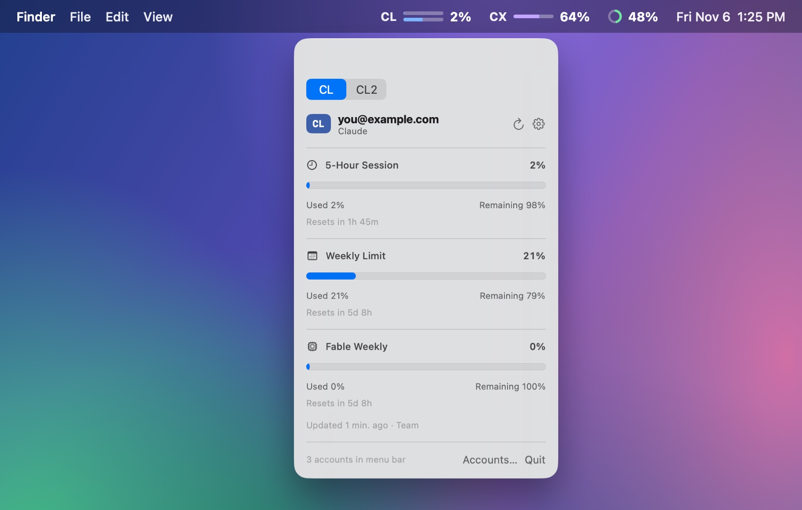
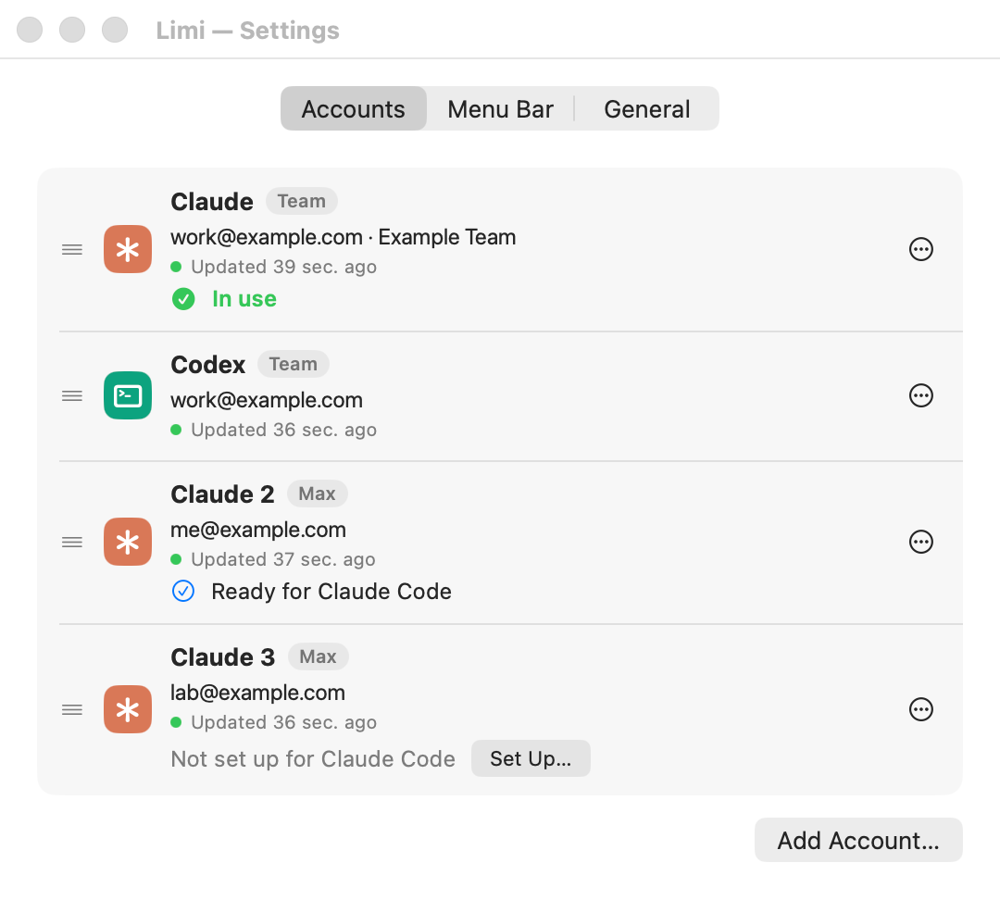
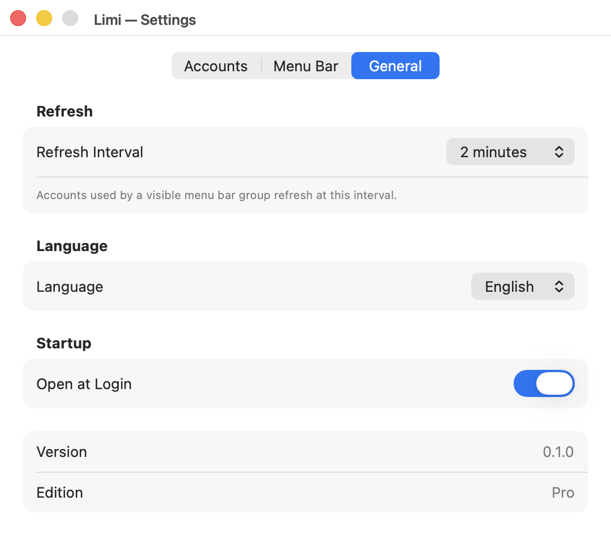
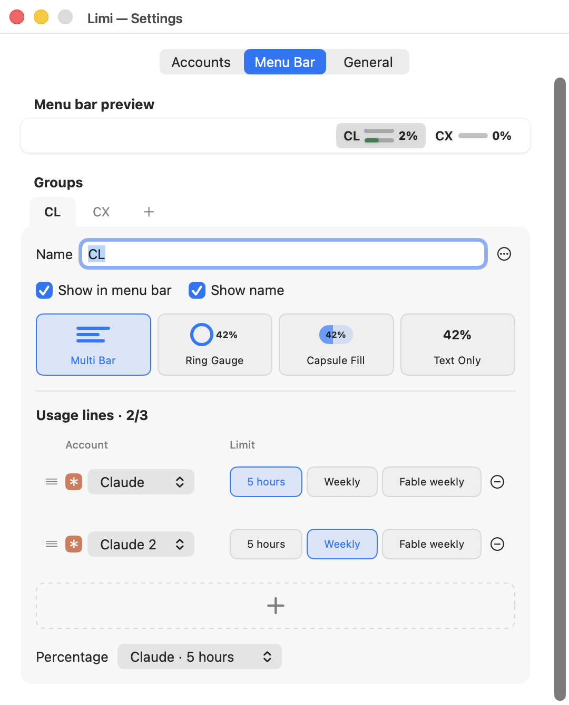
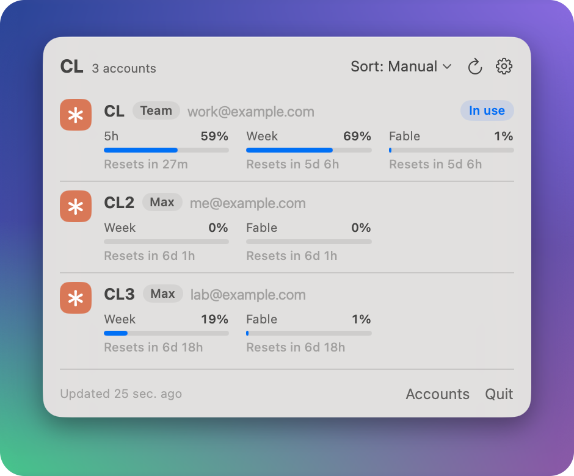
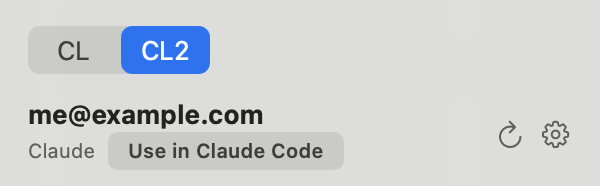

<p align="center">
  
</p>

<h1 align="center">Limi</h1>

<h3 align="center">Your AI usage limits, in one menu bar.</h3>

<p align="center">
  See the 5-hour and weekly limits of several Claude Code and Codex accounts right in your menu bar.<br>
  Switch the account Claude Code uses in one click, without signing in again. Your account details stay on your Mac.
</p>

<p align="center">
  <a href="https://github.com/kalti-lab/limi/releases/latest/download/Limi.zip"></a>
</p>

<p align="center">
  <a href="https://kalti.co.kr/limi"><b>Website</b></a> &nbsp;·&nbsp; <a href="https://kalti.co.kr"><b>KALTI</b></a> &nbsp;·&nbsp; <b>English</b> | <a href="README.ko.md">한국어</a>
</p>

<p align="center">
  <a href="https://github.com/kalti-lab/limi/releases/latest"></a>
  
  <a href="LICENSE"></a>
</p>

<p align="center">
  
</p>

## IN ACTION

<table>
  <tr>
    <td align="center" valign="top" width="50%">
      <br>
      <b>Several accounts</b><br><sub>Claude Code and Codex accounts side by side</sub>
    </td>
    <td align="center" valign="top" width="50%">
      <br>
      <b>General settings</b><br><sub>Refresh interval, language, open at login</sub>
    </td>
  </tr>
  <tr>
    <td align="center" valign="top">
      <br>
      <b>Make the menu bar yours</b><br><sub>Groups, styles and the limits to show</sub>
    </td>
    <td align="center" valign="top">
      <br>
      <b>Switch accounts with tabs</b><br><sub>Several accounts in one group</sub>
    </td>
  </tr>
</table>

## KEY CAPABILITIES

<table>
  <tr>
    <td valign="top" colspan="2">
      <br>
      <b>Switch Claude Code accounts in one click</b> <sup>NEW</sup><br>
      Choose which of your Claude accounts your own <code>claude</code> uses. After a one-time sign-in no browser opens, and open sessions follow within 30 seconds.<br><br>
      
    </td>
  </tr>
  <tr>
    <td valign="top" width="50%">
      <br>
      <b>All your accounts at a glance</b><br>
      Add Claude Code and Codex accounts together and see each one's 5-hour and weekly limits.
    </td>
    <td valign="top" width="50%">
      <br>
      <b>The look you want</b><br>
      Choose Multi Bar, Ring Gauge, Capsule Fill or Text Only, and group your accounts. It turns red past 90%.
    </td>
  </tr>
  <tr>
    <td valign="top">
      <br>
      <b>Your accounts stay on your Mac</b><br>
      Sign-in details stay on this Mac. Nothing is sent to KALTI.
    </td>
    <td valign="top">
      <br>
      <b>English and Korean</b><br>
      English by default, or pick Korean in Settings.
    </td>
  </tr>
</table>

Also in Limi:

- **Use in Claude Code**: switch the login your own `claude` uses to one of your Claude accounts in one click, without the browser each time ([how it works](#use-in-claude-code)).
- **Antigravity** (experimental): the one account signed in to `agy` or the Antigravity app on this Mac.
- Claude's per-model weekly limits and Antigravity's model groups, when the service reports them.
- Up to three usage lines in each menu bar group, taken from any accounts and limits (Ring Gauge shows one, Text Only any number). Drag groups, lines and accounts to reorder them.
- A value Limi could not read shows as `--`, never a made-up 0%, and older values are marked as cached.
- Refreshes every 1, 2, 5 or 10 minutes, or on demand. Only accounts shown in the menu bar are refreshed.
- Open at Login.

## DOWNLOAD

<table>
  <tr>
    <td>
      <h3>OPEN SOURCE &nbsp;<sub>Free</sub></h3>
      <ul>
        <li>Multiple accounts</li>
        <li>Add groups, change styles, edit lines</li>
        <li>Language choice, reconnect and error messages</li>
        <li>Open source under the MIT License</li>
      </ul>
      <p><b>$0</b> / free forever</p>
      <p>
        <a href="https://github.com/kalti-lab/limi/releases/latest/download/Limi.zip"></a>
        <a href="https://kalti.co.kr/limi"></a>
      </p>
    </td>
  </tr>
</table>

Runs on Macs with Apple silicon and macOS 14 or later.

1. Download **Limi.zip** from [kalti.co.kr/limi](https://kalti.co.kr/limi) or the [latest GitHub release](https://github.com/kalti-lab/limi/releases/latest).
2. Unzip it, move **Limi.app** to Applications and open it.

Limi is signed with a Developer ID and notarized by Apple. It updates itself with [Sparkle](https://sparkle-project.org) and checks for a new version about once a day.

## REQUIREMENTS

<p>
   &nbsp;A Mac with Apple silicon, macOS 14 (Sonoma) or later<br>
   &nbsp;The official Claude Code or Codex command-line tool (installed with Homebrew, ideally)<br>
   &nbsp;A subscription sign-in for each account. Usage on API keys isn't shown.
</p>

## GETTING STARTED

Limi starts with no accounts, so it opens **Settings › Accounts**. Click **Add Account…** and choose a service. Each service you add needs its official command-line tool:

| Service | Needs | How you sign in |
|---|---|---|
| Claude | [Claude Code](https://code.claude.com/docs/en/setup) (`claude`) | Limi runs `claude auth login --claudeai` in a folder of its own for that account and opens Claude's sign-in page in your browser. |
| Codex | [Codex CLI](https://github.com/openai/codex) (`codex`) | Limi starts `codex app-server` in a folder of its own for that account and opens the ChatGPT sign-in page. |
| Antigravity (experimental) | [`agy`](https://antigravity.google/cli), signed in | Run `agy` once in Terminal and sign in. Limi reads the account signed in there. Without `agy`, Limi reads the Antigravity app while the app is open. |

- Before your first Claude account, Limi explains how it keeps Claude sign-ins and asks you to agree (see [Claude and Anthropic's terms](#claude-and-anthropics-terms)).
- To add an account other than the one your browser is signed in to, choose **Switch account** on Claude's approval page (this also switches your claude.ai login) or **Sign in with another account** on the ChatGPT page. **Use Private Window Instead** in Limi signs in from a private browser window, apart from your usual browser session.
- Signing in through Limi does not change the login of your own `claude` or `codex`. Only **Use in Claude Code** changes your `claude` login, when you press it.
- Limi looks for the tools in these places, not in your shell's `PATH`:
  - `claude`: `/opt/homebrew/bin`, `/usr/local/bin`, `~/.local/bin`, `~/.bun/bin`
  - `codex`: `/opt/homebrew/bin`, `/usr/local/bin`, `~/.bun/bin`
  - `agy`: `~/.local/bin` (or the Antigravity app in `/Applications`)
- Limi starts these tools through `/usr/bin/python3`, which comes with the Xcode Command Line Tools (`xcode-select --install`).

Then set up the menu bar in **Settings › Menu Bar**: add groups, pick a style and choose the limits each group shows. Click a group in the menu bar for details. Opening Limi again from Applications brings Settings back.

## BUILD FROM SOURCE

Requires macOS 14 or later and Swift 6.2 or later (Xcode 26 or later).

```sh
git clone https://github.com/kalti-lab/limi.git
cd limi
swift test
./scripts/build-app.sh
open Limi.app
```

The first build downloads [Sparkle](https://github.com/sparkle-project/Sparkle) and checks it against a fixed SHA-256. `./scripts/build-app.sh --help` lists the options. Signing is optional: unless you give the script a signing identity, it signs the app ad hoc, which is enough to run it on your own Mac.

## HOW IT WORKS AND PRIVACY

Limi has no server and no account of its own. It reads the sign-ins stored on this Mac and asks each service directly.

- **Sign-ins.** Every account you add gets a private folder under `~/.agentbar/multi-account-v1/` that only your macOS user can read, and Limi reads the sign-in it keeps there. Limi never imports, follows or changes the logins of your own `claude`, `codex` or `agy`, except that **Use in Claude Code** changes your `claude` login when you press it ([below](#use-in-claude-code)). Deleting an account in Settings removes its sign-ins and cached usage.
- **Claude.** Limi calls Anthropic's OAuth usage API (`api.anthropic.com/api/oauth/usage`) itself with the account's token, and names itself `Limi/<version>` in the request. When the token expires, Limi renews it itself with the refresh token, and only for accounts Limi manages. Right after sign-in, Limi copies the credential Claude Code saved in the Keychain into the account's folder once; after that it reads only that file.
- **Codex.** Limi reads through the official `codex app-server` (`account/read` and `account/rateLimits/read`), started separately for each account with its own `CODEX_HOME`. The Codex CLI makes the network requests.
- **Antigravity.** Limi never holds the Antigravity sign-in. It runs `agy -p /usage`, which prints the quota report without starting a model turn, so it uses no quota. Limi runs it without a terminal and with nothing it could open a browser with, so a signed-out `agy` stops at once and the account asks you to sign in. Without `agy`, Limi asks the Antigravity app's local server (`127.0.0.1`) while the app is open.
- **Nothing goes to KALTI.** Limi has no analytics or telemetry. It connects to kalti.co.kr only to check for updates, and update files are downloaded from GitHub Releases.

### Use in Claude Code

In a Claude account's panel, **Use in Claude Code** switches the login your own `claude` uses (its default login, the Keychain item `Claude Code-credentials`) to that account. Every Claude Code session moves to it, open ones within about 30 seconds, and Remote Control disconnects. The account Claude Code uses shows **In Claude Code**.

- **Set up once per account.** In **Settings › Accounts**, **Set Up…** has Claude Code sign that account in through your browser, into a folder of its own (`~/.agentbar/multi-account-v1/lend/<account ID>/`). This login is separate from the one Limi reads usage with, so switching never stops the usage display.
- **Only Claude Code writes a login.** Limi runs `claude auth login` with the account's refresh token in `CLAUDE_CODE_OAUTH_REFRESH_TOKEN` ([Claude Code's environment variables](https://code.claude.com/docs/en/env-vars)), and for this reads Keychain items only through `/usr/bin/security`, so no Keychain prompt appears.
- **A refresh token is used once.** Handing a login over uses it up, so Limi never hands the same one over twice. The login Claude Code had goes back to its own account, so switching back needs no browser either. If an open session renews that login in the middle of a switch, that account is set up once more.
- **Checked afterwards.** Limi reads Claude Code's login again after switching and says so if it is not the account you chose. If Claude Code is signed in to an account that isn't in Limi, Limi asks first, since switching removes that login from Claude Code. Quitting waits for a running switch to finish (up to 90 seconds); if Limi still stops halfway, it finishes or undoes the switch on its next launch.
- **Read only when you look.** To show **In Claude Code**, Limi checks which account Claude Code uses when you open a panel or **Settings › Accounts**, or press refresh: whether its Keychain item exists (never the token) and the account in `~/.claude.json`. The periodic refresh does not, so nothing can bring up a Keychain window while you are away.
- **Logged without tokens** in `~/.agentbar/multi-account-v1/logs/claude-code-switch.log` (**Open Log**).
- Needs Claude Code 2.1.309 or later. Deleting an account removes its saved sign-in for Claude Code; Claude Code's own login stays as it is. Only the app has it: `swift run` and development runs with `AGENTBAR_DATA_DIR` or `AGENTBAR_DEFAULTS_SUITE` set do not.

### Claude and Anthropic's terms

Anthropic's [terms for Claude Code](https://code.claude.com/docs/en/legal-and-compliance) limit apps that keep Claude sign-ins, so Anthropic could block these reads at any time. Limi says so and asks once, before your first Claude account. If Anthropic blocks the reads, the account tells you so instead of asking you to reconnect, since reconnecting cannot help. **Use in Claude Code** switches only when you press it, and only between accounts you signed in to yourself; it never switches on its own, for example when a limit is reached.

### Antigravity and Google's terms

Google's [Antigravity terms](https://antigravity.google/terms) do not allow other software to use an Antigravity sign-in, which is why Limi asks `agy` or the app instead. Neither is a documented interface, so an Antigravity update may stop it from working.

## DISCLAIMER

Limi is an unofficial app. It is not affiliated with, endorsed by or sponsored by Anthropic, OpenAI or Google. It reads usage in ways these companies can change or block at any time, and Limi may stop working when they do. Claude, Claude Code, ChatGPT, Codex, Antigravity and other product names are trademarks of their respective owners.

## CREDITS

Limi by [jsiksn](https://github.com/jsiksn). Based on [AgentBar](https://github.com/chenjingdev/agent-bar) by [chenjingdev](https://github.com/chenjingdev).

## LICENSE

[MIT](LICENSE)

<br>

<p align="center">
  <a href="https://kalti.co.kr"><picture><source media="(prefers-color-scheme: dark)" srcset="docs/images/kalti-wordmark-dark.svg"></picture></a>
</p>
<p align="center">
  <sub>Made by KALTI — <a href="https://kalti.co.kr">kalti.co.kr</a> · <a href="mailto:support@kalti.co.kr">support@kalti.co.kr</a></sub>
</p>
